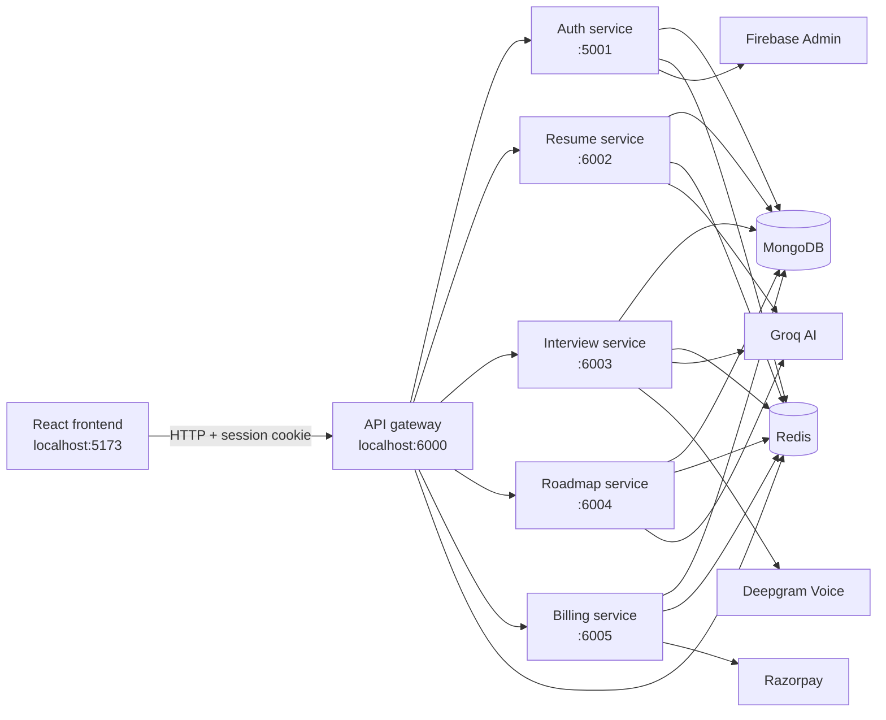

# Glangen

Glangen is an AI-assisted career preparation platform for students and early-career developers. It combines resume analysis, mock interviews, personalized learning roadmaps, profile management, and a coin-based billing system in one React application backed by small Node.js services.

## What the application provides

- Google sign-in through Firebase Authentication
- Persistent, Redis-backed login sessions
- PDF resume parsing, structured resume extraction, and AI scoring
- Technical and HR mock interviews tailored to a role and optionally to an uploaded resume
- Browser voice input and AI question playback through Deepgram
- Per-answer feedback plus an overall interview report and summary
- AI-personalized learning roadmaps with prerequisite-aware progress tracking
- A resume builder with printable/downloadable output
- User profile and career-goal management
- Razorpay checkout for purchasing interview coins

## Technology stack

| Area | Technology |
| --- | --- |
| Frontend | React 19, Vite 8, React Router, Redux Toolkit, Tailwind CSS, Motion |
| Visual tools | Monaco Editor, React Flow, ELK.js, Recharts |
| Backend | Node.js, Express, ES modules |
| Authentication | Firebase Authentication and Firebase Admin |
| AI orchestration | LangChain, LangGraph, Groq |
| Voice | Deepgram speech-to-text and text-to-speech |
| Data | MongoDB with Mongoose |
| Session and cache | Redis with ioredis |
| Payments | Razorpay |
| File processing | Multer and pdf-parse |

## System architecture



The browser calls only the API gateway. The gateway validates the `session` cookie for protected routes, reads the session from Redis, and forwards trusted `x-user-id` and `x-session-id` headers to the appropriate internal service. Internal services should therefore not be exposed publicly in production.

## How the main workflows operate

### 1. Sign-in and session handling

1. The frontend opens Google sign-in with the Firebase Web SDK.
2. Firebase returns an ID token to the browser.
3. The browser sends that token to `POST /api/auth/login`.
4. The auth service verifies it with Firebase Admin and creates the MongoDB user if this is their first login.
5. A random session ID is stored in Redis for seven days.
6. The gateway returns the session ID as an HTTP-only cookie. Every protected request must include this cookie.
7. Logout removes the Redis session and clears the cookie.

### 2. Resume analysis

1. An authenticated user uploads a PDF (maximum 20 MB).
2. Multer temporarily stores the file under the resume service's `uploads` directory.
3. `pdf-parse` extracts readable text from the PDF.
4. The resume agent sends the text to Groq and normalizes the structured AI response.
5. The analysis, score, score history, skills, experience, education, and projects are saved in MongoDB.
6. The latest result is cached in Redis and the temporary PDF is deleted.
7. The frontend uses the saved data for the scorer, resume builder, interview context, and roadmap context.

### 3. AI interview

1. The user selects an interview type and target role and can include resume context.
2. A LangGraph workflow calls the interview agent to generate the question set.
3. The interview and its current question are stored in MongoDB.
4. For each answer, the feedback agent evaluates the response and advances the interview.
5. When all questions are answered, the summary agent creates the final report.
6. Interview lists/results are cached in Redis and invalidated when the interview changes.
7. Voice answers are uploaded to Deepgram for transcription. A short-lived Deepgram token lets the browser play questions through the configured TTS WebSocket.

### 4. Personalized roadmap

1. The user selects a supported role and target compensation, optionally using resume data.
2. The service loads the built-in curriculum for Frontend Developer, Backend Developer, or Machine Learning Engineer.
3. The Groq personalization agent chooses emphasis and priority based on the user's target and background.
4. The roadmap builder creates nodes, prerequisite edges, resources, difficulty, duration, and availability states.
5. MongoDB stores the roadmap; Redis caches individual roadmaps and each user's roadmap list for one hour.
6. Topic updates validate prerequisites before unlocking downstream topics.

### 5. Coins and billing

The current coin costs are:

| Action | Coins |
| --- | ---: |
| Resume scorer | 10 |
| Roadmap builder | 20 |
| Start interview | 50 |
| Download PDF | 10 |

The current `starter` plan costs ₹199 and credits 300 coins. The billing service creates a Razorpay order, verifies the returned HMAC signature, records the payment, credits the user only once, and refreshes the cached session balance.

## Project layout

```text
glangen/
├── frontend/                         React/Vite client
│   ├── public/                       Static images and branding
│   └── src/
│       ├── apis/                     Gateway request helpers
│       ├── components/               Shared and feature components
│       ├── pages/                    Route-level screens
│       ├── redux/                    Resume state and store
│       └── utils/                    Axios, Firebase, and voice utilities
├── backend/
│   ├── docker-compose.yaml           Local Redis container
│   ├── gateway/                      Public API gateway and auth middleware
│   ├── shared/redis/                 Shared Redis client
│   └── services/
│       ├── auth/                     Firebase login, sessions, users, profiles
│       ├── resume/                   PDF parsing and resume analysis
│       ├── interview/                Interview graph, feedback, and voice
│       ├── roadmap/                  Curriculum personalization and progress
│       └── billing/                  Razorpay orders and coin credits
└── README.md
```

## Prerequisites

Install or create the following before starting:

- Node.js `20.19+` or `22.12+` (required by Vite 8)
- npm
- MongoDB, either local or a MongoDB Atlas connection string
- Redis, either local or Docker Desktop
- A Firebase project with Google sign-in enabled
- A Firebase service-account JSON key for the backend
- A Groq API key
- A Deepgram API key for interview transcription and voice playback
- Razorpay test keys for the billing flow

## External service setup

### Firebase

1. Create or select a project in the Firebase console.
2. In **Authentication → Sign-in method**, enable Google.
3. Register a Web app and retain its client configuration for `frontend/.env`.
4. In **Project settings → Service accounts**, create a private key.
5. Save it as `backend/services/auth/serviceAccountKey.json`.

The service-account file and all `.env` files are ignored by Git. Never commit real credentials.

### Groq, Deepgram, and Razorpay

1. Create an API key in Groq and use the same key in the resume, interview, and roadmap service environments.
2. Create a Deepgram key with the permissions needed for speech-to-text and temporary voice tokens.
3. Create Razorpay test credentials and use test mode during local development.

## Local installation

Clone the repository and enter it:

```powershell
git clone <repository-url>
cd glangen
```

Install every package using its lock file. From the project root in PowerShell:

```powershell
$projects = @(
  "frontend",
  "backend",
  "backend/gateway",
  "backend/services/auth",
  "backend/services/resume",
  "backend/services/interview",
  "backend/services/roadmap",
  "backend/services/billing"
)

foreach ($project in $projects) {
  npm --prefix $project ci
}
```

## Environment configuration

Copy every example file first:

```powershell
Copy-Item frontend/.env.example frontend/.env
Copy-Item backend/gateway/.env.example backend/gateway/.env
Copy-Item backend/services/auth/.env.example backend/services/auth/.env
Copy-Item backend/services/resume/.env.example backend/services/resume/.env
Copy-Item backend/services/interview/.env.example backend/services/interview/.env
Copy-Item backend/services/roadmap/.env.example backend/services/roadmap/.env
Copy-Item backend/services/billing/.env.example backend/services/billing/.env
```

Then replace placeholders with real values.

### Frontend: `frontend/.env`

```dotenv
# This must match the gateway port. The committed example currently says 8000;
# use 6000 for the provided gateway configuration.
VITE_BACKEND_URL=http://localhost:6000

VITE_FIREBASE_API_KEY=your_firebase_web_api_key
VITE_FIREBASE_AUTH_DOMAIN=your-project.firebaseapp.com
VITE_FIREBASE_PROJECT_ID=your-project-id
VITE_FIREBASE_STORAGE_BUCKET=your-project.firebasestorage.app
VITE_FIREBASE_MESSAGING_SENDER_ID=your_sender_id
VITE_FIREBASE_APP_ID=your_firebase_app_id
VITE_RAZORPAY_CHECKOUT_URL=https://checkout.razorpay.com/v1/checkout.js
```

### Gateway: `backend/gateway/.env`

```dotenv
PORT=6000
REDIS_URL=redis://localhost:6379
AUTH_SERVICE_URL=http://localhost:5001
RESUME_SERVICE_URL=http://localhost:6002
INTERVIEW_SERVICE_URL=http://localhost:6003
ROADMAP_SERVICE_URL=http://localhost:6004
BILLING_SERVICE_URL=http://localhost:6005
FRONTEND_URL=http://localhost:5173
```

### Auth service: `backend/services/auth/.env`

```dotenv
PORT=5001
MONGODB_URL=mongodb://localhost:27017/fresher-ai
REDIS_URL=redis://localhost:6379
NODE_ENV=development
FIREBASE_SERVICE_ACCOUNT_PATH=../serviceAccountKey.json
DNS_SERVERS=8.8.8.8,1.1.1.1
```

`FIREBASE_SERVICE_ACCOUNT_PATH` is resolved relative to `backend/services/auth/configs/firebase.js`; the value above points to `backend/services/auth/serviceAccountKey.json`.

### Resume and roadmap services

Use the corresponding port (`6002` or `6004`) in each service's `.env`:

```dotenv
PORT=6002
MONGODB_URL=mongodb://localhost:27017/fresher-ai
REDIS_URL=redis://localhost:6379
GROQ_API_KEY=your_groq_api_key
DNS_SERVERS=8.8.8.8,1.1.1.1
```

### Interview service: `backend/services/interview/.env`

```dotenv
PORT=6003
MONGODB_URL=mongodb://localhost:27017/fresher-ai
REDIS_URL=redis://localhost:6379
GROQ_API_KEY=your_groq_api_key
DEEPGRAM_API_KEY=your_deepgram_api_key
DEEPGRAM_TRANSCRIPTION_URL=https://api.deepgram.com/v1/listen
DEEPGRAM_MODEL=nova-3
DEEPGRAM_LANGUAGE=en
DEEPGRAM_TOKEN_URL=https://api.deepgram.com/v1/auth/grant
DEEPGRAM_TTS_WEBSOCKET_URL=wss://api.deepgram.com/v2/speak
DEEPGRAM_TTS_MODEL=flux-haley-en
DEEPGRAM_TTS_SAMPLE_RATE=24000
DNS_SERVERS=8.8.8.8,1.1.1.1
```

### Billing service: `backend/services/billing/.env`

```dotenv
PORT=6005
MONGODB_URL=mongodb://localhost:27017/fresher-ai
AUTH_MONGODB_DATABASE=auth
REDIS_URL=redis://localhost:6379
RAZORPAY_KEY_ID=your_razorpay_test_key_id
RAZORPAY_KEY_SECRET=your_razorpay_test_key_secret
DNS_SERVERS=8.8.8.8,1.1.1.1
```

When using the provided local MongoDB URL, verify that `AUTH_MONGODB_DATABASE` matches the database that contains the auth service's users collection. If all services use the `fresher-ai` database, set this value accordingly.

## Start the application

### 1. Start MongoDB

Start the local MongoDB service, or make sure every `MONGODB_URL` points to a reachable Atlas deployment.

### 2. Start Redis

With Docker Desktop running:

```powershell
docker compose -f backend/docker-compose.yaml up -d
```

To stop it later:

```powershell
docker compose -f backend/docker-compose.yaml down
```

### 3. Start the backend processes

Open one terminal for each command and run them from the project root:

```powershell
npm --prefix backend/services/auth run dev
```

```powershell
npm --prefix backend/services/resume run dev
```

```powershell
npm --prefix backend/services/interview run dev
```

```powershell
npm --prefix backend/services/roadmap run dev
```

```powershell
npm --prefix backend/services/billing run dev
```

After the services are ready, start the gateway:

```powershell
npm --prefix backend/gateway run dev
```

### 4. Start the frontend

In another terminal:

```powershell
npm --prefix frontend run dev
```

Open [http://localhost:5173](http://localhost:5173). The gateway health response is available at [http://localhost:6000](http://localhost:6000).

## Service ports

| Process | Port | Public in local development |
| --- | ---: | --- |
| Frontend | 5173 | Yes |
| API gateway | 6000 | Yes |
| Auth service | 5001 | Through gateway |
| Resume service | 6002 | Through gateway |
| Interview service | 6003 | Through gateway |
| Roadmap service | 6004 | Through gateway |
| Billing service | 6005 | Through gateway |
| Redis | 6379 | No |
| MongoDB | 27017 | No |

## API overview

All paths below are called through the gateway at `http://localhost:6000`. Protected endpoints require the HTTP-only session cookie created at login.

| Method | Route | Purpose | Protected |
| --- | --- | --- | --- |
| `POST` | `/api/auth/login` | Exchange a Firebase ID token for a session | No |
| `GET` | `/api/auth/logout` | Delete the session and clear its cookie | Session-aware |
| `GET` | `/api/auth/profile` | Get the signed-in user's profile | Yes |
| `PATCH` | `/api/auth/profile` | Update editable profile fields | Yes |
| `POST` | `/api/auth/use-coins` | Spend coins for a supported action | Yes |
| `GET` | `/api/me` | Read the gateway's cached session user | Yes |
| `POST` | `/api/resume/upload` | Upload and analyze a PDF resume | Yes |
| `GET` | `/api/resume/get-resume` | Get the user's latest resume analysis | Yes |
| `POST` | `/api/interview/start` | Generate and start an interview | Yes |
| `POST` | `/api/interview/answer` | Submit an answer and get the next step | Yes |
| `POST` | `/api/interview/transcribe` | Transcribe an audio answer | Yes |
| `POST` | `/api/interview/voice/token` | Create a short-lived Deepgram voice token | Yes |
| `GET` | `/api/interview/all` | List the user's interviews | Yes |
| `GET` | `/api/interview/:id` | Get one interview and its report | Yes |
| `POST` | `/api/roadmap/generate` | Generate a personalized roadmap | Yes |
| `GET` | `/api/roadmap/all` | List the user's roadmaps | Yes |
| `GET` | `/api/roadmap/:id` | Get a roadmap | Yes |
| `PATCH` | `/api/roadmap/:id/topics/:topicId/progress` | Update topic progress | Yes |
| `DELETE` | `/api/roadmap/:id` | Delete a roadmap | Yes |
| `POST` | `/api/billing/create` | Create a Razorpay order | Yes |
| `POST` | `/api/billing/verify` | Verify payment and credit coins | Yes |

## Frontend routes

Public pages are `/`, `/about`, `/faq`, `/privacy`, and `/terms`. Signed-in pages are `/dashboard`, `/scorer`, `/resume`, `/interview`, `/interview/:id`, `/interview/:id/report`, `/roadmap`, `/billing`, `/feedback`, and `/profile`.

## Verification and production build

Run frontend linting:

```powershell
npm --prefix frontend run lint
```

Create a production frontend bundle:

```powershell
npm --prefix frontend run build
```

Preview the generated bundle locally:

```powershell
npm --prefix frontend run preview
```

The backend packages currently do not include an automated test suite. Their `start` scripts run without the development file watcher:

```powershell
npm --prefix backend/gateway start
npm --prefix backend/services/auth start
# Repeat for resume, interview, roadmap, and billing.
```

## Troubleshooting

### The frontend cannot reach the API

- Confirm `VITE_BACKEND_URL=http://localhost:6000` in `frontend/.env`.
- Restart Vite after changing an environment file.
- Confirm the gateway is listening on port `6000` and `FRONTEND_URL` exactly matches the browser origin.

### Login returns 401

- Confirm Google sign-in is enabled in Firebase.
- Confirm the frontend Firebase values and backend service-account key belong to the same Firebase project.
- Confirm `FIREBASE_SERVICE_ACCOUNT_PATH` points to valid JSON.
- Check that Redis is reachable because login sessions are stored there.

### Protected requests return `Unauthorized` or `Session Expired`

- Sign in again and ensure requests include credentials; the included Axios client already sets `withCredentials: true`.
- Confirm the gateway and auth service share the same `REDIS_URL`.
- Do not mix `localhost` and another hostname for the frontend/gateway during cookie-based local development.

### MongoDB connection fails

- Start the local MongoDB service or allow your IP in MongoDB Atlas.
- Check every service's `MONGODB_URL`.
- Ensure the billing service's `AUTH_MONGODB_DATABASE` points to the database containing users.

### Resume analysis fails

- Upload a readable PDF smaller than 20 MB; image-only/scanned PDFs may not contain extractable text.
- Confirm the resume service has a valid `GROQ_API_KEY`.
- Run the service from its package directory through `npm --prefix` so its temporary `uploads` directory is created in a predictable location.

### Interview voice fails

- Confirm the browser has microphone permission.
- Check `DEEPGRAM_API_KEY` and the configured Deepgram URLs/model.
- Voice services require internet access even when the application runs locally.

### Payment completes but coins do not update

- Use matching Razorpay key ID and secret from the same mode (test or live).
- Confirm the verification request reaches `/api/billing/verify` with the active session.
- Confirm the billing service can access both the billing records and the auth users collection.

## Security and deployment notes

- Keep `.env` files, Firebase service-account JSON, API keys, and Razorpay secrets out of version control.
- Use HTTPS in production. With `NODE_ENV=production`, the session cookie is `Secure` and `SameSite=None`.
- Restrict auth, resume, interview, roadmap, billing, Redis, and MongoDB to the private network; expose only the frontend and gateway.
- Set `FRONTEND_URL` to the exact deployed frontend origin so credentialed CORS requests work.
- Use managed MongoDB and Redis with authentication and encrypted connections.
- Configure process supervision/container orchestration for all six backend processes.
- Add rate limiting, structured logging, health checks, request validation, and automated tests before a production launch.

## Current development notes

- Only Redis has a Docker Compose definition; the Node services and MongoDB are started separately.
- The root backend package contains the shared Redis dependency but no combined start script.
- The frontend example uses port `8000`, while the gateway example and code default to `6000`. Use `VITE_BACKEND_URL=http://localhost:6000` unless you deliberately place another proxy on port `8000`.
- No automated backend tests are configured yet.

